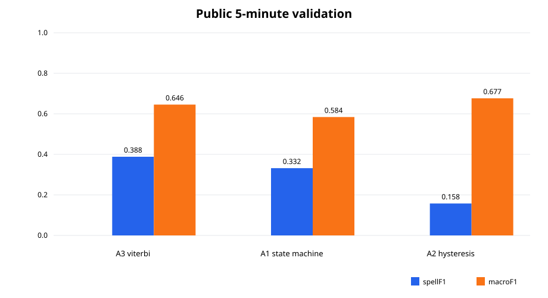

# Comparison of the three approaches

The comparison uses the supplied labelled five-minute window only after inference. None of its
labels are imported by `possession_models.py`, and no parameter is trained or selected from this
window.

## Public-window results

| Rank | Approach | spellF1 | macroF1 | Predicted possessions | Mean duration |
|---:|---|---:|---:|---:|---:|
| 1 | Constrained Viterbi | **0.3882** | 0.6456 | 17 | 16.7 s |
| 2 | State machine | 0.3319 | 0.5842 | 30 | 9.7 s |
| 3 | Hysteresis | 0.1576 | **0.6766** | 49 | 5.5 s |



The Viterbi decoder is best on the ranking metric. Hysteresis has the highest frame-level
`macroF1` but the worst `spellF1`; its 49 predicted possessions show that it fragments the match.
That disagreement is precisely why the challenge ranks by possessions rather than frames.

Reproduce everything with:

```bash
python solutions/run_approaches.py
python evaluation/validate_submission.py evaluation/results/top3/approach_1_state_machine.csv
python evaluation/validate_submission.py evaluation/results/top3/approach_2_hysteresis.csv
python evaluation/validate_submission.py evaluation/results/top3/approach_3_viterbi.csv
```

Machine-readable results are in `evaluation/results/top3/comparison_metrics.json`; the generated
plot is `evaluation/results/top3/comparison.svg`.

The public window contains only 17 true possessions. Its ranking is therefore a diagnostic, not a
reliable estimate of the private full-match ordering. The challenge documentation demonstrates
that it can reverse the ranking of simple alternatives.
